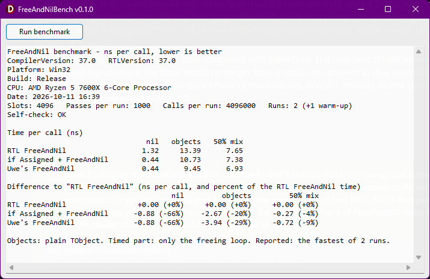

# Delphi FreeAndNil benchmark

Is `if Assigned(X) then FreeAndNil(X)` faster than a plain `FreeAndNil(X)`?

## Why I made it

In my book [*Delphi in all its glory - Reaching for the gods*](https://www.amazon.com/Delphi-all-its-glory-Reaching/dp/B0CTQPNB56) (Part 2 of the series) I recommend FreeAndNil over Free, and I say that its cost is negligible. A claim in a book needs a proof, so I measured it, together with the old question: does the "if" in front of FreeAndNil buy any speed?  

The full story is on my website: [if Assigned(X) then FreeAndNil(X): is the check faster? I measured it](https://gabrielmoraru.com/freeandnil-if-assigned-benchmark/).

## What it measures

Four ways to free an object:

- `FreeAndNil(X)` - the RTL's own
- `if Assigned(X) then FreeAndNil(X)`
- `FreeAndNilBetter(X)` - a FreeAndNil that tests nil itself and then calls Destroy directly
- `X.Free` - leaves X dangling, so it is only a speed reference

Each way runs over 4096 slots that are all nil, all objects (plain TObject, the cheapest destructor there is), or a 50% random mix. Only the freeing loop is timed: 4 million calls per run, one warm-up run, then the fastest of 5 runs. Before any timing, a self-check proves that every way frees every object exactly once.

## Results

Delphi 13, Release build, AMD Ryzen 5 7600X. Nanoseconds per call, lower is better:

```
Win32                         X is nil   X is an object
X.Free                            0.92             9.67
FreeAndNil(X)                     0.92            10.01
if Assigned + FreeAndNil          0.37            10.23
Better FreeAndNil                 0.37             9.30

Win64                         X is nil   X is an object
X.Free                            1.11            10.34
FreeAndNil(X)                     1.11            10.28
if Assigned + FreeAndNil          0.37            10.09
Better FreeAndNil                 0.55             9.57
```

Conclusion: FreeAndNil costs the same as Free. When X is nil, the "if" saves about 0.6-0.7 ns per call. When X holds an object, the "if" makes no difference you can rely on. 



## How to run it

- `FreeAndNilBench.dpr` - my VCL front end (a button and a memo, see `screenshot.png`). The Release build needs only the RTL and the VCL, so it compiles in a stock Delphi. The Debug build also uses FastMM4 and the optional [Autopilot for Delphi](https://gabrielmoraru.com/my-delphi-code/autopilot-for-delphi/) bridge, which lets an AI assistant drive the running app.
- `FreeAndNilBench.Core.pas` - the measuring unit. Call `RunFreeAndNilBenchmark` from your own program.
- `Console\FreeAndNilBenchConsole.dpr` - for a quick check with no dependencies: RTL units only, compiles in a stock Delphi. It prints the report and saves it as `Results - Win32.txt` or `Results - Win64.txt` beside the exe.

Build in Release mode: a debug memory manager changes the cost of freeing.

## More

- My website: [gabrielmoraru.com](https://gabrielmoraru.com)
- My books, the five-part series *Delphi in all its glory*: [gabrielmoraru.com/publications-citations](https://gabrielmoraru.com/publications-citations/)
